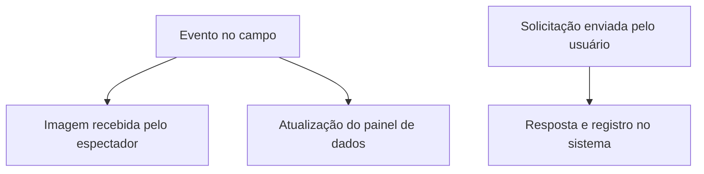

# Apostas ao vivo: tempo do jogo, atrasos e regras de apuração

**Conteúdo e fontes revisados em 9 de outubro de 2026.** Entenda o significado de apostas ao vivo, como interpretar informações recebidas durante uma partida e quais documentos ajudam a conferir um registro antigo.

**O que são apostas ao vivo?** São apostas registradas enquanto o evento esportivo está em andamento, também chamadas de *in-play*. A expressão identifica o momento do registro. Para compreender a seleção, ainda é necessário conferir o mercado, o período considerado e as condições de apuração.

**Situação atual no Brasil:** a Secretaria de Prêmios e Apostas informa que a MP nº 1.394/2026 proibiu a exploração, a oferta, a intermediação e a publicidade de apostas de quota fixa. O alcance inclui apostas esportivas e jogos online, inclusive ofertas de agentes sediados no exterior a pessoas localizadas no Brasil. [Confira a orientação oficial da Fazenda, atualizada em 7 de outubro de 2026](https://www.gov.br/fazenda/pt-br/composicao/orgaos/secretaria-de-premios-e-apostas/medida-provisoria-ndeg-1-394-2026-entenda-as-novas-regras-para-as-apostas-de-quota-fixa).

  

Este guia usa modelos didáticos para interpretar informações e registros. Equipes, horários e placares dos exemplos são fictícios; os intervalos não são medições de uma transmissão ou plataforma.

  

## Neste guia

- [Aposta ao vivo, transmissão e placar](#aposta-ao-vivo-transmissão-e-placar)
- [Como entender os diferentes atrasos](#como-entender-os-diferentes-atrasos)
- [Exemplo de linha do tempo](#exemplo-de-linha-do-tempo)
- [Mercado suspenso e status da aposta](#mercado-suspenso-e-status-da-aposta)
- [Total da partida ou gols restantes](#total-da-partida-ou-gols-restantes)
- [VAR: decisão esportiva e tratamento do registro](#var-decisão-esportiva-e-tratamento-do-registro)
- [Como conferir uma aposta ao vivo antiga](#como-conferir-uma-aposta-ao-vivo-antiga)
- [Perguntas frequentes](#perguntas-frequentes)
- [Fontes e método](#fontes-e-método)

## Aposta ao vivo, transmissão e placar

A expressão “ao vivo” pode aparecer em uma transmissão, em um painel de resultados ou na descrição de um registro. Identifique qual informação está sendo apresentada.

  

| Informação | O que ela descreve | O que conferir |
| --- | --- | --- |
| Registro de aposta ao vivo | Aposta relacionada a um evento em andamento | Confirmação, horário e condições |
| Transmissão do jogo | Imagens ou áudio recebidos pelo espectador | Fonte e momento de recepção |
| Painel de placar | Dados sobre o andamento do evento | Fonte, atualização e eventual correção |
| Resultado usado na apuração | Informação aplicada ao mercado | Fonte prevista e período considerado |

Para comparar uma aposta pré-jogo e uma aposta ao vivo, separe o momento de registro do alcance da seleção. Um registro feito durante a partida pode se referir ao resultado final ou a um período específico, conforme a descrição do mercado.

Assistir a uma imagem e consultar um painel são formas de acompanhar informações. Para conferir a aceitação e o tratamento de uma aposta, procure os documentos associados ao registro.

## Como entender os diferentes atrasos

As regras gerais do Sportsbook da Betfair alertam que imagens e dados descritos como ao vivo podem chegar com atraso, e que placares exibidos também podem estar atrasados ou imprecisos. Essa referência documenta limites das informações apresentadas por aquele produto. [Consulte as seções In-Play Betting e Score Displays](https://support.betfair.com/app/answers/detail/general-sports-betting-rules).

O esquema abaixo organiza três caminhos de informação. Ele é conceitual e não representa a arquitetura técnica de uma empresa.

Compare separadamente o tempo da imagem, o tempo dos dados e o tempo da solicitação. Uma diferença observada entre dois caminhos não determina, sozinha, o atraso do terceiro.

Também pode existir um intervalo de processamento da solicitação. A documentação do Exchange da Betfair descreve a aplicação de atraso a pedidos em mercados em andamento. Esse mecanismo pertence às condições do produto e deve ser distinguido do atraso da transmissão. [Veja a explicação técnica sobre o atraso de pedidos in-play](https://support.betfair.com/es/app/answers/detail/3250-por-que-se-aplica-un-retraso-a-la-realizacion-de-apuestas-en-juego/).

Ao revisar uma ocorrência, evite juntar todos esses intervalos em um único número chamado “atraso do site”. Identifique quais momentos foram documentados e quais permanecem desconhecidos.

## Exemplo de linha do tempo

Considere uma partida fictícia entre **Equipe A e Equipe B**. Para este exercício, todos os horários usam a mesma referência de relógio, em **20 de setembro de 2026, UTC−3**. Essa equivalência é uma premissa do modelo.

| Horário fictício | Ocorrência no exemplo |
| --- | --- |
| 21:06:00 | Um gol acontece no campo |
| 21:06:04 | Uma solicitação é enviada pelo usuário |
| 21:06:05 | O painel recebe a atualização do placar |
| 21:06:06 | Uma resposta sobre a solicitação é recebida |
| 21:06:08 | A imagem do gol chega ao espectador |

Neste modelo, a imagem chega **8 segundos** após o evento e a atualização do painel chega após **5 segundos**. O intervalo entre envio e resposta é de **2 segundos**. Cada número compara dois momentos diferentes.

O usuário envia a solicitação antes de receber a imagem, embora o gol já tenha ocorrido no campo. Essa sequência mostra por que o momento em que alguém viu uma jogada pode diferir do momento em que ela aconteceu.

A tabela não informa qual mercado foi escolhido, qual resposta foi recebida ou quais condições se aplicam. Para avaliar o registro, esses dados precisam ser acrescentados. Os horários, isoladamente, não estabelecem se a solicitação foi aceita nem qual foi seu tratamento final.

Em documentos reais, relógios diferentes podem ter referências distintas. Antes de comparar horários, confira fuso, origem e significado de cada campo.

  

## Mercado suspenso e status da aposta

O estado de um mercado e o estado de uma aposta são informações distintas. Uma indicação de suspensão em uma tela de mercado precisa ser lida separadamente da confirmação e do tratamento de um registro já existente.

| Informação observada | Pergunta para conferir o documento |
| --- | --- |
| Mercado identificado como suspenso | Qual mercado e em qual momento? |
| Mensagem após uma tentativa de envio | A resposta informa aceitação, recusa ou processamento? |
| Bilhete confirmado | Quais condições e qual horário constam do registro? |
| Registro posteriormente ajustado | Qual regra e qual ocorrência fundamentam o ajuste? |

Como exemplo documentado, as regras gerais do Sportsbook da Betfair preveem suspensão de mercados durante o evento e definem, para a regra de futebol indicada, ocorrências relevantes como gol, pênalti concedido e expulsão. A documentação também registra limites da suspensão no momento adequado. [Confira as condições específicas de suspensão durante o jogo](https://support.betfair.com/app/answers/detail/general-sports-betting-rules).

Uma tela que permaneceu aberta não resolve a situação de uma solicitação. Para esclarecer uma ocorrência, relacione a mensagem recebida, o registro e a condição que foi aplicada.

## Total da partida ou gols restantes

O horário de registro e o período coberto pelo mercado respondem a perguntas diferentes. Para ilustrar, considere uma partida que está em **A 1–0 B** quando a solicitação é registrada e termina em **A 2–0 B** no tempo regulamentar com acréscimos.

Neste exercício, definimos duas condições distintas:

| Condição do modelo | Quantidade considerada | Mais de 1,5? |
| --- | --- | --- |
| Total de gols da partida inteira | 2 gols ao final do período | Sim |
| Gols adicionais após o momento indicado no registro | 1 gol depois daquele momento | Não |

A primeira condição inclui o gol que já havia acontecido. A segunda considera apenas o trecho posterior definido para o exemplo. O momento de uma aposta ao vivo não transforma automaticamente uma seleção de total da partida em seleção de gols adicionais.

Para um registro específico, leia a descrição completa. Procure expressões que indiquem partida inteira, segundo tempo, próximo gol, intervalo delimitado ou outro recorte. Identifique também qual momento ou placar inicial a regra utiliza.

Se a descrição estiver incompleta nos documentos disponíveis, peça esclarecimento sobre o período considerado antes de comparar o resultado com a seleção.

## VAR: decisão esportiva e tratamento do registro

O protocolo da IFAB estabelece que a decisão final de uma revisão é tomada pelo árbitro. Também informa que não existe um limite máximo de tempo para o processo de revisão. [Consulte o protocolo oficial do VAR](https://www.theifab.com/laws/latest/video-assistant-referee-var-protocol/).

Para conferir uma aposta ao vivo de futebol, separe o momento do lance, a decisão após a revisão e a regra de tratamento do registro. Documentos de produtos diferentes podem estabelecer tratamentos diferentes:

- **Exchange da Betfair:** a regra consultada prevê anulação das apostas correspondidas entre um gol e seu cancelamento pelo VAR. [Leia a seção sobre ocorrências relevantes e VAR nas regras do Exchange](https://support.betfair.com/app/answers/detail/exchange-general-rules).
- **Sportsbook da Betfair:** a regra consultada prevê tratamento das apostas feitas entre o incidente e a decisão relacionada ao VAR, com exceções quando a decisão não foi alterada ou não influenciou materialmente a aposta. [Confira as condições de VAR nas regras de futebol do Sportsbook](https://support.betfair.com/app/answers/detail/a_id/10555/).

Essas referências pertencem aos produtos identificados. Para um bilhete específico, confira o documento aplicável à época e ao produto utilizado.

Imagine um gol fictício aos **31:10**, cancelado após revisão aos **33:20**. Um registro marcado como **32:00** está dentro desse intervalo no modelo. Ainda é necessário identificar o produto, a seleção, as condições e o significado do horário registrado para explicar seu tratamento.

## Como conferir uma aposta ao vivo antiga

Organize os documentos em uma sequência que permita responder:

1. **O que aconteceu no evento?** Identifique o lance ou o resultado e a fonte utilizada para situá-lo.
2. **O que foi exibido?** Guarde o conteúdo da captura, o momento em que ela foi obtida e a informação sobre a fonte.
3. **O que foi registrado?** Localize identificador, horário, seleção, cotação e resposta à solicitação.
4. **Qual era o alcance da seleção?** Confira período, linha e condições do mercado.
5. **Como o registro foi encerrado?** Relacione status final, eventual ajuste e fundamento informado.

O minuto de jogo, o relógio do dispositivo e o horário de um registro são referências diferentes. Se não houver dados suficientes para convertê-las, mantenha a diferença explícita na descrição da ocorrência.

Uma pergunta objetiva pode ser: “Qual horário e qual fonte foram utilizados para situar o lance em relação ao registro identificado como [referência]?” Outra é: “Qual regra explica o ajuste apresentado no histórico?”

## Perguntas frequentes

### Apostas ao vivo significam assistir ao jogo em tempo real?

A expressão descreve apostas durante um evento em andamento. A imagem recebida pelo espectador tem seu próprio caminho e pode ter atraso.

### Uma odd exibida em uma captura é a condição do bilhete?

Compare a captura com a confirmação e com as condições aplicáveis. A cotação exibida em um momento e a cotação associada a um registro precisam ser identificadas separadamente.

### A suspensão do mercado cancela todas as apostas anteriores?

A indicação de suspensão, sozinha, não informa o tratamento de cada registro. Confira a situação do bilhete e o fundamento de eventual alteração.

### Um total registrado durante o jogo considera só os gols seguintes?

Confira o período descrito. O exemplo deste guia mostra que um total da partida inteira e uma condição de gols adicionais podem produzir avaliações diferentes.

## Fontes e método

A situação atual no Brasil foi consultada na orientação da Secretaria de Prêmios e Apostas. As referências técnicas sobre atrasos, suspensão e VAR foram conferidas nas páginas dos produtos identificados; o protocolo esportivo foi consultado na IFAB.

O esquema, a cronologia e as tabelas foram elaborados para este guia. Não houve teste de transmissão, medição de latência ou uso de uma plataforma para registrar os exemplos.

**Última revisão: 9 de outubro de 2026.** Para sugerir uma correção, indique a fonte, a data e o trecho. Oculte dados pessoais em documentos compartilhados em comentários ou issues.
